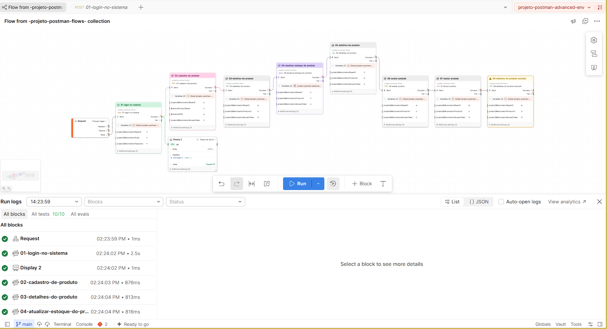

# Evidência — Postman Flows

## Configuração

- Collection: projeto-postman-flows
- Environment: projeto-postman-advanced-env
- Quantidade de requests: 8
- Criação do Flow: a partir da Collection

## Sequência de requisições

1. Autenticação do administrador
2. Cadastro de produto com dados dinâmicos
3. Consulta dos detalhes do produto
4. Atualização do estoque
5. Consulta do produto atualizado
6. Criação de avaliação
7. Exclusão do produto
8. Confirmação de que o produto excluído não é encontrado

## Execução com os valores corretos

O fluxo executou a sequência de requisições e apresentou os resultados dos testes.

Após a exclusão, a última consulta retornou HTTP 404, conforme esperado para um produto que não existe mais.

## Falhas controladas

### Autenticação

Foi utilizada temporariamente uma senha inválida.

A API retornou HTTP 401 e a saída Fail permitiu visualizar a falha de autenticação.

### Atualização do estoque

Foi enviado estoque 99, mantendo o teste com resultado esperado igual a 100.

A atualização foi aceita pela API, mas o teste identificou a diferença entre o valor recebido e o valor esperado.

## Recuperação

Após restaurar a senha correta e o estoque para 100, o fluxo foi executado novamente para conferir os resultados esperados.

## Configurações exploradas

- Saídas Success e Fail.
- Display para visualizar dados e resultados.
- Roteamento considerando falhas nos testes.
- Pausa de um bloco para conferir a resposta anterior.
- Cores para organizar visualmente os blocos.

## Evidência visual

