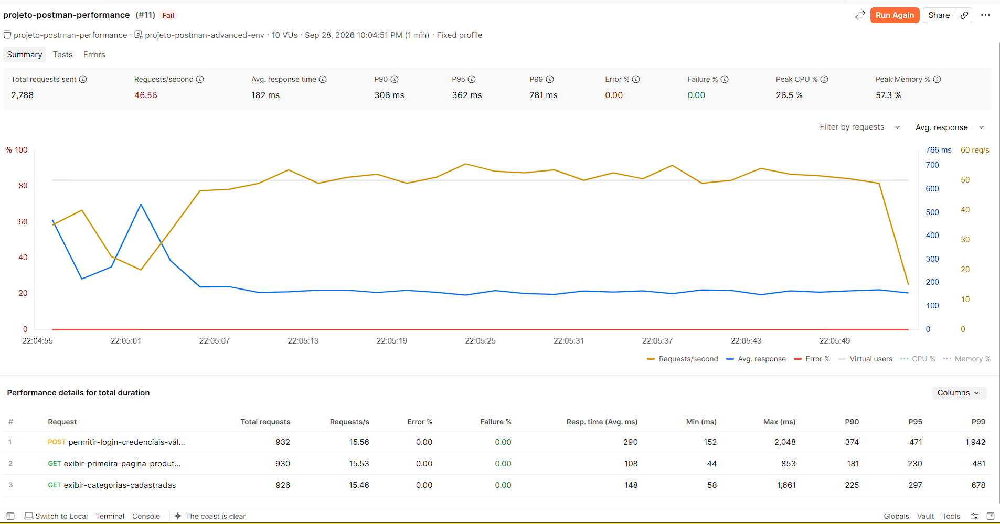

# Evidência de Performance — Fixed com Reprovação Controlada

## Configuração

- Perfil: Fixed
- Usuários virtuais: 10
- Duração: 1 minuto
- Critério: Requisições por segundo sendo maior ou igual 200

## Resultado

- Status geral: reprovado
- Request/second: 46.56
- Error %: 0%
- Failure %: 0%

## Análise

A execução foi reprovada porque as requisições não se aproximaram das 200 assinaladas para o cenário.

As requisições continuaram sendo executadas e as validações funcionais permaneceram aprovadas.

Portanto, a reprovação está relacionada ao critério de desempenho e não à indisponibilidade funcional da API.

## Evidência visual

