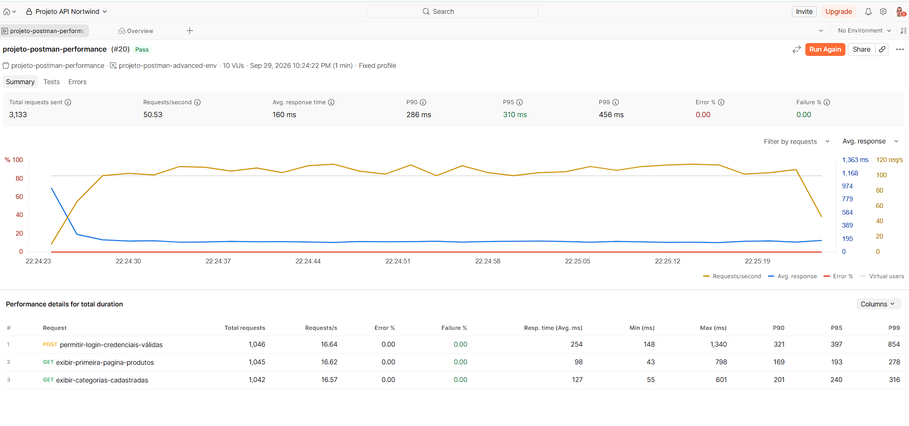

# Evidência de Performance — Postman CLI

## Configuração

- Collection: projeto-postman-performance
- Environment: projeto-postman-advanced-env
- Ferramenta: Postman CLI
- Execução: Collection e Environment identificados por IDs
- Perfil de carga: Fixed
- Usuários virtuais: 10
- Duração: 1 minuto
- Critério de aprovação: P95 inferior a 1.000 ms

## Resultado geral

- Status: aprovado
- Total de requisições: 3.133
- Requisições por segundo: 50,53
- Tempo médio de resposta: 160 ms
- P90: 286 ms
- P95: 310 ms
- P99: 456 ms
- Taxa de erros: 0%
- Taxa de falhas nas assertions: 0%

## Resultado por request

| Request                                 | Execuções | Req/s |  Média |    P95 |    P99 |   Máximo |
| --------------------------------------- | --------: | ----: | -----: | -----: | -----: | -------: |
| POST permitir-login-credenciais-válidas |     1.046 | 16,64 | 254 ms | 397 ms | 854 ms | 1.340 ms |
| GET exibir-primeira-pagina-produtos     |     1.045 | 16,62 |  98 ms | 193 ms | 278 ms |   798 ms |
| GET exibir-categorias-cadastradas       |     1.042 | 16,57 | 127 ms | 240 ms | 316 ms |   601 ms |

## Análise

O cenário foi aprovado porque o P95 geral obtido foi de 310 ms, permanecendo abaixo do limite definido de 1.000 ms.

Durante um minuto, dez usuários virtuais enviaram 3.133 requisições, alcançando uma média de 50,53 requisições por segundo.

Não foram identificados erros de comunicação nem falhas nas assertions. A distribuição das execuções também permaneceu equilibrada entre as três requests da Collection.

O login apresentou o maior tempo médio, com 254 ms, e o maior P95, com 397 ms. Embora tenha ocorrido um tempo máximo isolado de 1.340 ms, esse pico não representa o comportamento da maioria das respostas.

O P99 do login foi de 854 ms, indicando que 99% das respostas desse endpoint permaneceram dentro desse valor.

As consultas de produtos e categorias apresentaram tempos menores e comportamento estável durante a execução.

## Observação sobre o Environment

As credenciais utilizadas no login precisaram ser compartilhadas no Postman Cloud para que o Postman CLI, executando a Collection e o Environment pelos respectivos IDs, pudesse acessá-las.

Os valores das credenciais não foram incluídos nesta evidência nem versionados no repositório.

## Evidência visual

