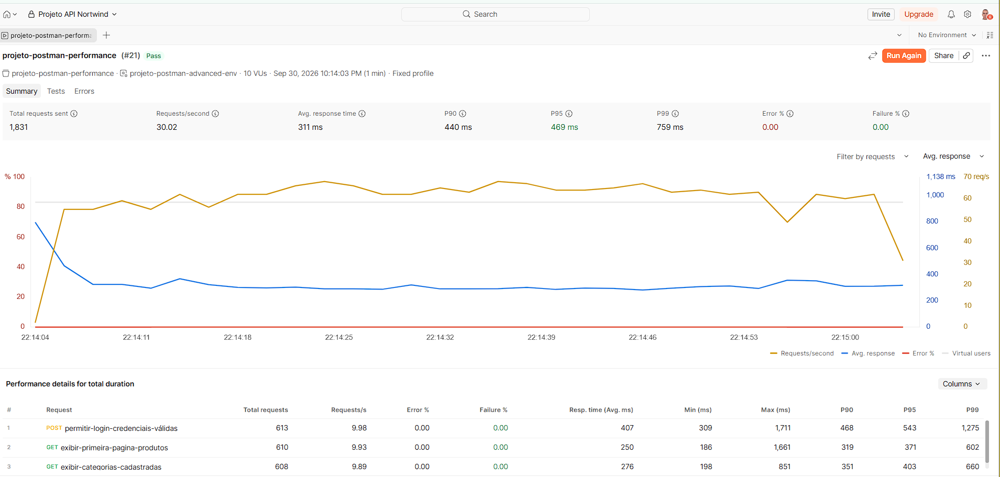

# Evidência de Performance — GitHub Actions

## Configuração

- Collection: projeto-postman-performance
- Environment: projeto-postman-advanced-env
- Ferramenta: GitHub Actions com Postman CLI
- Execução: Collection e Environment identificados por IDs
- Perfil de carga: Fixed
- Usuários virtuais: 10
- Duração: 1 minuto
- Critério de aprovação: P95 inferior a 1.000 ms

## Resultado geral

- Status: aprovado
- Total de requisições: 1.831
- Requisições por segundo: 30,02
- Tempo médio de resposta: 311 ms
- P90: 440 ms
- P95: 469 ms
- P99: 759 ms
- Taxa de erros: 0%
- Taxa de falhas nas assertions: 0%

## Resultado por request

| Request | Execuções | Req/s | Média | P95 | P99 | Máximo |
|---|---:|---:|---:|---:|---:|---:|
| POST permitir-login-credenciais-válidas | 613 | 9,98 | 407 ms | 543 ms | 1.275 ms | 1.711 ms |
| GET exibir-primeira-pagina-produtos | 610 | 9,93 | 250 ms | 371 ms | 602 ms | 1.661 ms |
| GET exibir-categorias-cadastradas | 608 | 9,89 | 276 ms | 403 ms | 660 ms | 851 ms |

## Análise

O cenário foi aprovado porque o P95 geral foi de 469 ms, permanecendo abaixo do limite definido de 1.000 ms.

Durante um minuto, dez usuários virtuais enviaram 1.831 requisições, alcançando uma média de 30,02 requisições por segundo.

Não foram identificados erros de comunicação nem falhas nas assertions. A distribuição das execuções permaneceu equilibrada entre as três requests da Collection.

O login apresentou o maior tempo médio, com 407 ms, e o maior P95, com 543 ms. Embora tenha ocorrido um tempo máximo isolado de 1.711 ms, esse pico não representa o comportamento da maioria das respostas.

O P99 geral foi de 759 ms, indicando que 99% das respostas permaneceram dentro desse valor.

## Observação sobre a execução

A carga foi gerada por uma máquina temporária do GitHub Actions, e não pelo computador local.

A Collection e o Environment foram acessados no Postman Cloud pelos respectivos IDs. As credenciais permaneceram no Environment compartilhado e não foram incluídas nesta evidência nem versionadas no repositório.

## Evidência visual

